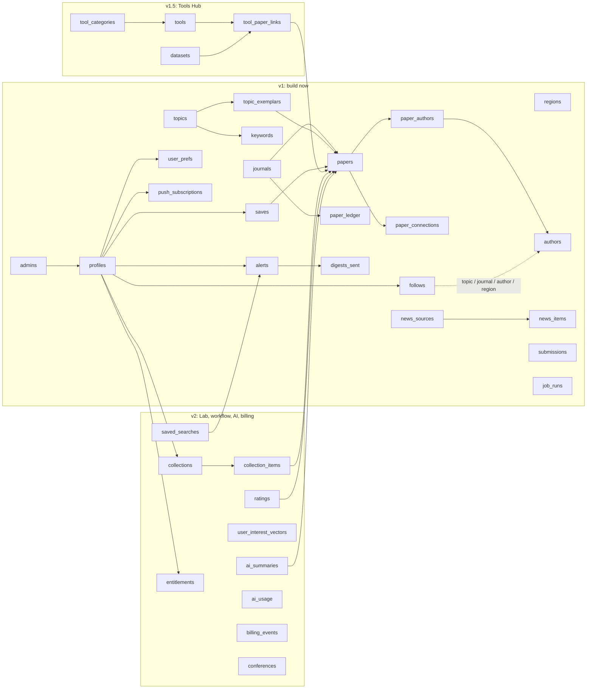

# Architecture: PROJECT_NAME (a clean-room rebuild of CoastFolio's features, plus a Tools Hub, Lab and workflow)

Inputs: recon.md, features.csv (103 rows, release-tagged), decisions.md D001–D009, data-sources.md, data/journals.json, PRODUCT.md, design/shape-brief.md.
Status: **draft for CHECKPOINT (b)**. Reviewed by the ECC database-reviewer and architect agents on 2026-10-21; their fixes are applied (see the Review log at the end).

## Stack

| layer | choice | why |
| --- | --- | --- |
| web | **Next.js (App Router) + TypeScript**, RSC for the feed and paper pages, client components for sheets and filters | Ali's preference. RSC + streaming + CDN caching gets the feed under 1.5 s on 4G. Intercepted routes give "sheet over feed + a real `/paper/[doi]` page" (shape brief) |
| styling | **Tailwind v4** + tokens from `replica/design/tokens.json` as CSS variables, **cva + clsx** | one token source |
| UI | **base-ui**, **motion**, **Sonner**, **Virtuoso**, **zustand**, **next-themes**, TanStack Query, zod | D008 |
| PWA | **Serwist** service worker (precache shell; stale-while-revalidate feed; cache-first saved papers; offline write queue), manifest, **Web Push (VAPID, `web-push`)** | offline saved papers + alerts. iOS push only after install (16.4+) |
| database | **Supabase Postgres, region ap-south-1 (Mumbai)** + pgvector `halfvec(384)` HNSW + `tsvector` FTS + pg_trgm (authors) | one DB for papers, vectors, search and users. Mumbai is closest to Ali and South Asian users |
| data access | Supabase JS + RLS for anything the browser touches. Workers use a dedicated **`ingest_worker` Postgres role** (writes only catalogue/job tables) over the **Supavisor transaction pooler**, with typed SQL (Kysely) | RLS is the authorisation layer. A leaked worker secret can't touch user tables (architect review) |
| migrations | Supabase CLI SQL migrations (`supabase/migrations`), generated TS types. A **staging** Supabase project (free) with seed data | SQL-first. pgvector/tsvector don't fit ORMs |
| auth | **Supabase Auth: Google OAuth** + anonymous local mode (IndexedDB) merged by `merge_local_state()` (validated, capped, idempotent) | D004. No anonymous auth rows |
| embeddings | **gte-small 384-d via transformers.js in both runtimes** (Node in the worker for documents; Supabase Edge Function for search queries), pinned model revision + dtype, mean pooling + normalisation; `papers.embed_model` records the version; **CI parity test** (50 strings, cosine ≥ 0.995) | free. Same library in both places removes the mismatch risk. Search fuses vector + FTS results by reciprocal rank fusion, so any drift degrades gracefully |
| jobs | **GitHub Actions cron** for the Node jobs (ingest, preprints, citations, Crossref updates, merge, alerts; tools crawl in v1.5), with `concurrency:` groups, `workflow_dispatch`, `actions/cache` for the model. **pg_cron + pg_net → Edge Function** for news, plus pg_cron for rollups and pruning. **Healthchecks.io** dead-man's switch per job | Vercel Hobby cron is daily-only and its timeouts are tight. Edge Function CPU limits rule out embedding |
| email (v2) | **Resend** + React Email; SPF/DKIM/DMARC; one-click unsubscribe | — |
| payments (v2) | **Paddle** (merchant of record) behind the provider-agnostic `entitlements` table; **Lemon Squeezy** fallback | see "Payments" |
| AI (v2) | **Claude API**: Haiku 5.5 (abstract summaries, student mode), Sonnet 5.5 (OA full text, Q&A, compare). Server-side key, cache keyed `(paper, kind, model, prompt_version)`, per-user caps | cost section |
| maps (v2) | MapLibre GL + OpenFreeMap tiles (re-check terms at v2) | no key, no lock-in |
| errors / analytics | Sentry (PII scrubbed), Umami Cloud (cookieless) | privacy-first |
| hosting | **Vercel, functions pinned to `bom1` (Mumbai)**. Hobby through v1 (no revenue, non-commercial), **Pro when billing goes live in v2** | the Hobby terms allow it while nothing is sold |
| backups | Supabase Pro daily (7 days) + **weekly `pg_dump` → Backblaze B2** from Actions + a restore drill before launch | Pro has no point-in-time recovery without an add-on |

Deliberately not used: microservices, a separate vector DB, Redis (Postgres + CDN cache suffice to 100k users), Vercel Cron, and Semantic Scholar on the critical path (licence unclear: data-sources.md).

## Schema

Tables: **36** (v1: 24, v1.5: 4, v2: 8). Access rules: **Postgres RLS on every table**.
- Catalogue: public read, `ingest_worker`/service write.
- User tables: owner-only via `(select auth.uid())`.
- Internal tables: RLS on with no policies.
- `profiles.plan` can only be written by the billing webhook (column-level grant).
- Free alert cap is enforced by a trigger.

Full SQL: [`replica/schema.sql`](schema.sql). **Verified on 2026-10-21** by applying it to Postgres 17 + pgvector with Supabase auth stubs and running two smoke tests:
- owner isolation
- idempotent, validated merge
- the DOI shape check
- no self-upgrade to premium
- the alert cap
- the duplicate-follow block
- anon can't call RPCs or write the catalogue
- the feed query uses `papers_feed_date_idx` with keyset pagination

Key design points:
- **DOI + preprint merge.**
  - `doi` is unique, lower-case, and shape-checked (`^10\.\d{4,9}/\S+$`).
  - A preprint and its published version are two rows linked by `published_version_id` (allowed only on preprints).
  - Every feed index is partial on `published_version_id is null`, so a merged preprint disappears from feeds.
  - The `preprint_merge` job moves saves and links to the published row.
- **Ledger vs papers.** Every fetched work goes to `paper_ledger`; only classified works go to `papers`. Journal counts come from the ledger (count parity with the reference app).
- **Feed queries** use keyset pagination: `(pub_date, id) < ($d, $id) order by pub_date desc, id desc`. There are matching `(sort_key desc, id desc)` partial indexes for Newest, Most cited, Trending and First seen. Topic/region filters use GIN on `smallint[]`. Add `btree_gin (topic_ids, pub_date)` only if EXPLAIN on real data asks for it.
- **Search:** generated `search_tsv` (English for title/abstract with the abstract capped at 20k chars, `simple` for authors) + author trigram. Vector results are fused in.
- **Money:** `price_cents int` + `currency char(3)`. **Time:** `timestamptz` UTC everywhere; `profiles.timezone` (IANA) drives labels and alert hours.

## Ingestion plan and refresh schedule

| job | runner | schedule (UTC) | what it does | idempotency |
| --- | --- | --- | --- | --- |
| `ingest_papers` | Actions | `15 */3 * * *` (every 3 h) | OR-batches of ≤50 OpenAlex source IDs, `from_created_date = last_ok − 1 day`, cursor paging, `select=` fields only → ledger upsert → rebuild abstract → classify (keywords → embedding similarity) → upsert `papers`/`authors`/`paper_authors` → embed → revalidate CDN tags | `job_runs.run_key` + natural-key upserts + advisory lock |
| `ingest_preprints` | Actions | `45 */6 * * *` | arXiv API (`physics.ao-ph`, `physics.geo-ph` + gated cross-lists; 1 req / 3 s), Crossref prefix 10.22541 `essoar.*`, EarthArXiv OAI-PMH, SSRN (1 OpenAlex strict search/day) → strict gate → free OpenAlex singleton enrich → classify/upsert | DOI / arxiv_id |
| `refresh_citations` | Actions | `30 2 * * *` (< 2 yr daily; older on Sundays) | OR-filter 100 IDs/call → `cited_by_count`, `counts_by_year`, `trending_score` | `citations_refreshed_at` watermark |
| `crossref_updates` | Actions | `0 3 * * *` | retractions / corrections via Crossref `update-to` → `retraction_status` | notice DOI |
| `preprint_merge` | Actions | after each ingest | preprint ↔ published relations; move saves/links | pair key |
| `dispatch_alerts` | Actions | hourly `5 * * * *` (public repo); falls back to the tail of `ingest_papers` (3-hourly send slots) if the repo is private | users whose local `send_hour` is now → My Feed since `last_sent_at` → web-push; prune 404/410 | `digests_sent (alert_id, period_key)` unique |
| `ingest_news` | pg_cron + pg_net → Edge Fn | `10 * * * *` hourly | conditional GET (ETag) on 7 feeds, relevance filter, upsert | `news_items.url` unique |
| `rollups` | pg_cron | `20 * * * *` | 30-day counts per journal (ledger), per topic, per region → summary table for the filter sheets | — |
| `prune` | pg_cron | `0 4 * * *` | `job_runs` > 90 d, news > 180 d, dead push subs | — |
| `backup` | Actions | Sundays | `pg_dump` → B2 | date key |
| `tools_crawl`, `link_tools_papers` [v1.5] | Actions | daily / after ingest | GitHub/ecosyste.ms/PyPI/conda/Zenodo → scored → moderation; link extraction → `tool_paper_links` | `repo_url` unique; (paper, target, type) unique |

Every job:
- writes `job_runs` (running → succeeded/failed)
- retries 3× with backoff (2 s, 8 s, 32 s, honours `Retry-After`)
- pings Healthchecks.io
- logs OpenAlex `spend_usd` from the response headers

Spend alerts: a soft alert at $0.50/day, and a hard pause of non-critical jobs at **$0.80/day**. `/admin` shows runs, the moderation queue and spend.

**Expected OpenAlex spend:**
- launch: about **$0.05/day**; 10k users: about $0.10–0.30/day (free allowance is $1/day; breakdown in data-sources.md)
- launch backfill of 24 months: about 265k works, 2,650 list calls, **$0.27 one-off**

## DB size

Estimate per stored paper: about **7.5 KB** all-in. That's text + tsvector about 3.5 KB, halfvec + HNSW about 2.3 KB, other indexes and authors about 1.7 KB. Ledger about 0.1 KB/row. Re-measure after the first 1,000 real rows.

| stored papers / yr | scenario | 1 yr | 2 yr (launch backfill) | 5 yr |
| --- | --- | --- | --- | --- |
| 3k | strict, like the reference app (about 216 / 30 d) | 23 MB | 45 MB | 113 MB |
| **10k** | **expected** | **75 MB** | **150 MB** | **375 MB** |
| 30k | coarse gate + all preprints | 225 MB | 450 MB | 1.1 GB |
| ledger | 133k journal works + preprints per yr | 15 MB | 30 MB | 75 MB |

**Free tier (500 MB): fine for development and a private beta. Not for a public launch.**
- It pauses after 7 idle days and has no backups.
- The high scenario passes 500 MB within about 2 years.

**Launch on Supabase Pro ($25/mo, 8 GB, daily backups).** That covers every scenario well past 5 years.

## API

Browser → our API only. Never OpenAlex/Crossref/GitHub directly. Public reads are CDN-cached: `s-maxage` + stale-while-revalidate, with tags revalidated by the ingest worker through a secret webhook. `/paper/[doi]` uses ISR (on-demand + daily). My Feed is composed client-side from cached topic/journal slices plus a small per-user query.

| method path | does | who | input | output | flow |
| --- | --- | --- | --- | --- | --- |
| GET `/` (RSC) | Explore feed, first page streamed | anyone | sort, topics, journals, regions, window, new | HTML | F01, F03 |
| GET `/api/feed` | next page (keyset cursor) | anyone, rate-limited | filters + cursor | `{items, nextCursor}` | F03 |
| GET `/api/search` | FTS + vector (RRF) + author trigram, inside the search window | anyone, rate-limited | q, filters, cursor | items | F02 |
| GET `/paper/[doi]` | paper page / intercepted sheet (SEO, OG) | anyone | doi | HTML | F04 |
| GET `/api/papers/[id]/connections?kind=` | references / cited-by (OpenAlex, 7-day cache) / similar (HNSW) | anyone, rate-limited + daily budget | kind | `{total, items}` | F04 |
| GET `/journals`, `/journals/[slug]` | browser + drill-down | anyone | — | HTML | F06 |
| GET `/news` | news | anyone | source | HTML | F07 |
| GET `/feed` | My Feed (followed items since last visit); signed out: topic preview | signed in | — | HTML | F09 |
| GET `/authors/[id]` | author page + follow | anyone | — | HTML | F09 |
| actions `follow`, `unfollow` | — | signed in (RLS) | kind, target | ok | F09 |
| actions `save`, `unsave` | DB if signed in; IndexedDB otherwise (offline queue) | anyone | paper_id | ok | F05 |
| RPC `merge_local_state` | local → account (zod-validated at the route, re-validated in SQL, ≤2,000 saves) | signed in | saves[], prefs | void | F05 |
| action `updatePrefs` | topics, keywords, windows, journals, theme | signed in (local otherwise) | partial prefs | ok | F08 |
| POST/DELETE `/api/push/subscription` | VAPID subscription | signed in | subscription | ok | F09 |
| action `upsertAlert` | alert rule (DB trigger caps the free tier at 2) | signed in | channel, cadence, hour | ok | F09 |
| POST `/api/submissions` | keyword share (anon, IP-capped) / tool (v1.5, signed in) | anyone | payload | ok | F08 |
| POST `/api/revalidate` | CDN tag revalidation | worker (secret header) | tags | ok | — |
| GET `/admin/*` | jobs, moderation, spend | admins | — | HTML | admin |
| GET `…/opengraph-image` | Satori via next/og | anyone | — | PNG | SEO |
| [v1.5] `/tools`, `/tools/[slug]`, `/tools/compare` | catalogue, tool page, compare ≤3 | anyone | filters | HTML | — |
| [v2] POST `/api/ai/[paperId]` | summary / Q&A / compare (cached, capped) | premium | action, question | stream | — |
| [v2] POST `/api/billing/webhook` | Paddle → `billing_events` → `entitlements` + `profiles.plan` | Paddle (signature) | event | 200 | — |
| [v2] GET `/api/export` | BibTeX / RIS / CSL-JSON | signed in | ids, format | file | — |

Webhooks in: Paddle (v2). Out: none. Rate limiting is a per-IP token bucket in Postgres (an unlogged table) plus Vercel firewall rules. The tightest limits are on connections (they spend OpenAlex budget) and search (it embeds the query).

## Payments (v2), for a seller who is an individual in India selling worldwide

| | **Paddle** (MoR) | **Lemon Squeezy** (MoR, owned by Stripe) | **Razorpay** (gateway) | **Stripe India** (gateway) |
| --- | --- | --- | --- | --- |
| Can Ali sign up now? | yes, after a review of the live site + pricing + terms + refund policy *(approval not guaranteed for individuals)* | yes *(verify)*; being moved into Stripe Managed Payments (preview since Feb 2026), so the roadmap is uncertain | yes (PAN + bank; international activation needed) | **no**: new Indian accounts are invite-only, and international payments need a registered business + IEC + RBI purpose code |
| Fees (advertised, mostly third-party) | 5% + $0.50 | 5% + $0.50 (+ intl/subscription surcharges per some sources) | about 3% intl + 18% GST on the fee + about 1% subscriptions + FX markup | about 4.3% intl + 2% FX + GST |
| Global VAT / sales tax | **handled (MoR)** | **handled (MoR)** | **Ali's job** (EU VAT OSS, UK VAT… from the first sale) | Ali's job |
| Indian buyers | **UPI + UPI Autopay subscriptions, INR pricing** | cards/PayPal | best UPI/netbanking | cards |
| Payout to India | bank / Payoneer *(confirm FX in writing)* | via Stripe/PayPal (about 1% intl payout, unconfirmed) | INR, T+2 | INR |

**Recommendation: Paddle.**
- As an individual, a merchant of record is the only realistic way to sell to the EU, UK, US and Australia without registering for their sales taxes.
- Paddle takes UPI Autopay for Indian subscribers, which purchasing-power pricing needs.
- Lemon Squeezy is the fallback. Apply to Paddle **before** v2 starts.

At $3.49/mo the fixed $0.50 takes about 19%, so push an **annual plan** (e.g. $29/yr → about 6.7% fees). `/replica-entrepreneur` sets the final prices.

**Flag for a CA:** through a MoR, Ali's sale to Paddle is an export of services. GST registration is required only above ₹20 lakh/yr (zero-rated under an LUT once registered); keep FIRCs for payouts.

## Monthly cost by service (USD)

Assumptions (v2 lines): 3% of MAU on Premium; 40% of signed-in users take a weekly digest; 20 AI requests per Premium user per month; cache hit rate 50% at 10k and 75% at 100k; about $0.004 per uncached AI request (Haiku about $0.0006, Sonnet OA full text about $0.036, mix 90/10).

| service | 0 users (dev) | launch (v1, public) | 1k MAU | 10k MAU | 100k MAU |
| --- | --- | --- | --- | --- | --- |
| Supabase | $0 (Free) | $25 (Pro, Micro incl.) | $25 | $30 (Small) | $75 (Medium) |
| Vercel | $0 | $0 (Hobby, no revenue) | $0 → $20 once billing is live | $20 | $60 (about 30M edge requests) |
| GitHub Actions | $0 (public repo) | $0 | $0 | $0 | $0 |
| OpenAlex | $0 | $0 | $0 | $0 (about $0.30/day of $1) | $30 (prepaid top-ups) |
| Resend (v2) | $0 | $0 | $20 | $20 | $90–150 |
| Claude API (v2) | $0 | $0 | $1 | $12 | $60 |
| Backblaze B2 backups | $0 | <$1 | <$1 | <$1 | $1 |
| Healthchecks / Sentry / Umami | $0 | $0 | $0 | $0–20 | $46–66 |
| domain | — | $1 | $1 | $1 | $1 |
| **total** | **$0** | **≈ $26** | **≈ $47–67** | **≈ $85–105** | **≈ $365–445** |
| payment fees | — | — | % of revenue | % of revenue | % of revenue |

Revenue check (v2, 3% at $3.49): about $105 / $1,050 / $10,500 per month at 1k / 10k / 100k MAU. Service costs stay small next to that.

## The parts that bite

- **Time zones:** store UTC. HTML carries ISO strings, formatted on the client (Intl) to avoid hydration mismatch. Alerts use `profiles.timezone`. Tests cover IST (+5:30) and a DST zone.
- **Idempotency:** `job_runs.run_key`, natural-key upserts, `digests_sent` unique, `billing_events` PK, the merge RPC.
- **Races:** overlapping runs (Actions `concurrency` + advisory locks); two tabs merging (upsert); preprint merge vs a concurrent save (the merge job runs in one transaction).
- **Rate limits:** one throttled client per host (OpenAlex 30 rps + $; Crossref polite 3 rps lists; arXiv 1 per 3 s; S2 1 rps) with `Retry-After`.
- **Scheduler drift:** Actions crons can be late. GitHub disables schedules after 60 days of repo inactivity, so a keep-alive commit/dispatch plus the Healthchecks dead-man's switch catches it.
- **Secrets:** the service-role key lives only in GitHub Environments/Vercel server env, never `NEXT_PUBLIC_*`. Workers use the narrower `ingest_worker` role.
- **Offline:** shell + last feed page + saved papers are cached; save/unsave is queued while offline.
- **Push:** iOS needs install + a user gesture. Install prompt first, email as the fallback (v2).
- **Copyright:** abstracts only from sources, never full text, news snippets ≤ 400 chars, takedown path.
- **Security headers:** strict CSP, HSTS, `frame-ancestors 'none'`.
- **Privacy:** account deletion cascades from `auth.users`. Data export in Settings. Covers GDPR and India's DPDP Act. Sentry PII scrubbing.
- **Abuse:** anonymous keyword shares are IP-capped and moderated, never auto-applied.

## Build order (v1)

Every milestone: TDD (tdd-guide agent + ecc:tdd-workflow), then the code-reviewer agent, then `/impeccable audit` + `critique` before the next one. The security-reviewer runs after milestones 7 and 2 (workers).

| # | milestone | screens | tables | routes / jobs |
| --- | --- | --- | --- | --- |
| 0 | **Vertical slice**: ingest 5 journals → keyword classifier → plain feed → open paper → save locally | S02, S03 | journals, topics, keywords, papers, paper_ledger, job_runs | `ingest_papers` (local), `/`, `/paper/[doi]` |
| 1 | App shell: tab bar (4 visible; Tools flag off), header + avatar, themes, PWA manifest + SW | shell | — | — |
| 2 | Explore for real: 127 journals + 4 preprint servers, embedding classifier, search, all 4 sorts, Topic/Journal/Region sheets (incl. South Asia sub-regions), "New since last visit", infinite scroll, skeletons, pull-to-refresh, CDN caching | S02, S04 | regions, authors, paper_authors | `/api/feed`, `/api/search`, `refresh_citations`, `ingest_preprints`, `rollups` |
| 3 | Paper sheet: abstract, badges, DOI copy, share, local save, **References / Cited by / Similar** | S03, S11 | paper_connections | `/api/papers/[id]/connections` |
| 4 | Onboarding + Settings "Change my topics" | S01 | — | — |
| 5 | Journals browser + drill-down; News tab | S05, S05b, S06 | news_sources, news_items | `ingest_news` |
| 6 | Settings: windows, topics + keywords + share, journal toggles, theme | S09 | submissions | `updatePrefs`, `/api/submissions` |
| 7 | Auth + sync + merge; Feed tab (follows), author pages; push alerts (free cap) | S07, S08, S10 | profiles, user_prefs, follows, saves, push_subscriptions, alerts, digests_sent | Google OAuth, `merge_local_state`, `dispatch_alerts` |
| 8 | Admin; retraction badges; preprint merge; SEO + OG; backups + restore drill | admin | admins | `crossref_updates`, `preprint_merge`, OG, `backup` |
| 9 | Classifier eval (200 labelled → `classifier-eval.md`), 4G perf budget, a11y, final security review | — | — | — |

Then v1.5 (Tools Hub) and v2 (Lab, workflow, AI, Paddle).

## Risks and open questions

1. **Classifier strictness.** The coarse gate keeps 18% of works; the reference app shows about 2%. *Mitigation:* per-topic confidence thresholds tunable from `/admin`, measured on 200 labelled papers before launch.
2. **OpenAlex policy changes** (keys mandatory since Feb 2026; docs still mix credits and dollars). *Mitigation:* spend headers logged, $0.80/day hard stop, Crossref as a second DOI source per journal.
3. **Abstract gaps** (some publishers don't deposit abstracts). An honest empty state; we never scrape publishers.
4. **Semantic Scholar licence**: not needed for v1. Ali can email AI2 about commercial use before v2 recommendations.
5. **Google Flood Forecasting is a non-commercial pilot**, which conflicts with Premium. It stays off until written confirmation.
6. **Paddle approval for an individual** is not guaranteed. Apply early; Lemon Squeezy fallback.
7. **GitHub Actions schedule reliability**: dead-man's switch + manual dispatch.
8. **Question for Ali:** can the repo be **public** (open source)? It makes Actions free, fits "open", and allows hourly alert slots. Secrets stay in GitHub Environments either way.
9. **Question for Ali:** launch backfill depth. Proposed: 24 months.

## Review log (2026-10-21)

Database-reviewer, applied to schema.sql and re-tested:
- keyset indexes `(key desc, id desc)` partial on `published_version_id is null`
- `doi_shape` check + lower-case ledger DOI
- `preprint_link_only_from_preprint` check
- tsvector abstract capped at 20k chars (before first load)
- HNSW `m=16, ef_construction=128`, partial on non-null
- `follows_unique … nulls not distinct` + FK indexes
- **`profiles.plan` no longer user-writable** (column grants)
- free alert cap trigger
- execute revoked on internal functions; `merge_local_state` for authenticated only, validated and capped
- `paper_ledger.journal_id on delete restrict`
- title trigram index dropped
- `fillfactor 85`

Deferred: btree_gin composite (only if EXPLAIN on real data needs it), UUIDv7.

Architect agent, applied above:
- Mumbai regions for the DB and functions
- dedicated `ingest_worker` role + pooler
- transformers.js in both runtimes + parity test + `embed_model` + RRF
- news on pg_cron/pg_net; alerts in Node, not Deno
- Healthchecks.io + `workflow_dispatch` + concurrency groups
- CDN caching + revalidate webhook + ISR
- staging project, weekly off-site `pg_dump`, CSP, DPDP/GDPR
- Vercel Pro deferred until billing exists
